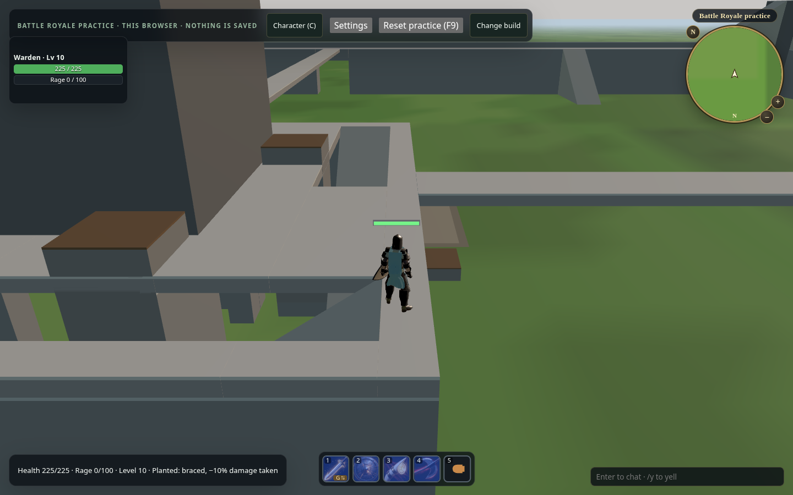
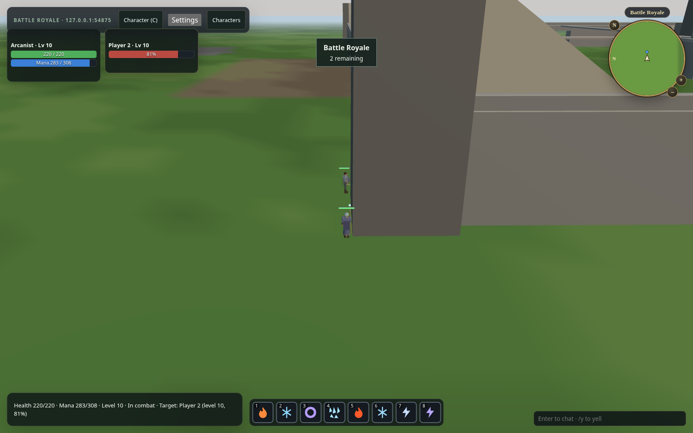

# Battle Royale in the MMORPG browser client

## Practice arena (Pages, no server)

`?activity=battle-royale` (or **Battle Royale PvP** from Activity) opens with **Arena:
Practice arena (this browser)** selected unless the URL names an `arenaServer`. Choose a
class, appearance and equipment, then **Start practice**: the page's `mmorpg-wasm` host
(`LocalZone.forPracticeArena`) admits that `EphemeralCharacterBuild` at the maximum level just
inside the fortress's south gate, facing the keep across the courtyard and five stationary
**Training Targets** (three about 8–9 m ahead, two at 21 m). Targets are breakable props: they take real `mmorpg-core` damage, never move, fight or
hold threat, break, and stand again after 30 s. There is no storm, matchmaking, team, reward
or other player. **Reset practice (F9)** starts a fresh life with the build chosen at entry;
**Change build** returns to setup to change it. On a phone the touch overlay shows **Target** and
**Attack** from the first moment, and **Menu** offers **Reset practice** and **Change build**;
in portrait the status line sits under the frames and the hotbar above the thumb controls
(#551). Nothing is saved, and the Greyhaven roster,
saves and the hosted path below are untouched.

## The fortress (#552)

Practice and hosted matches show the **same symmetric multilevel fortress** that Battle Royale
hosts ([battle-royale #31](https://github.com/moenarch-games/battle-royale/issues/31),
`docs/ARENA.md` there). `battle-royale-core` (pinned in the root `Cargo.toml`, with a `[patch]`
pointing its `mmorpg-core` at this workspace) is its one definition; nothing here copies the
geometry.

- **Physics**: the practice zone is the fortress's own colliders, ramps and eight lifts, unchanged,
  in `mmorpg-core` and Rapier, with its own spawn lattice in the south courtyard (slot 0 at
  (0, −76) m, 16 × 32 slots 2 m apart) and the training targets. A hosted match runs
  `arena::content()` itself; the client refuses projections whose content revision is not
  `ArenaPresentation.contentRevision()`, i.e. that fortress's.
- **Rendering**: `Scenery::graybox` turns every collider box into a graybox prop (walls, parapets
  and columns; towers; floors and bridges, each with a lighter walkable top) and every ramp into a
  wedge, drawn by the shared static scene. Lifts are the unit presenter's moving platforms at the
  projection's tick. The ground is the ordinary flat terrain.
- **Camera**: in the arena only, the orbit camera's eye is pulled in front of the first structure
  box between it and the character (`clearSightLine`), so it stays under the keep's roof and in
  front of walls; Greyhaven's camera is unchanged.

Everything is graybox and untextured: curtain wall, gates, corner towers, courtyard ramps, keep
corridors and hall, roof, bridges, central tower and lifts. Authored art comes later through
Blender → asset-tooling → this renderer and must keep the same collision.

`scripts/smoke-browser.py` walks courtyard → keep door → corridor → interior ramp → roof → central
tower lift → tower top through the page's real zone at desktop and phone size
(`test_battle_royale_fortress_walkthrough_*`), and `mmorpg-wasm`'s tests walk the same zone onto
the wall walk, a corner tower and a courtyard lift. `scripts/profile-browser.py --activity
battle-royale` profiles the arena.



## Hosted match

Choose **Arena: Hosted match**. Select a class, appearance and equipped
items, then join the same **Match server** as a friend. Characters enter at the
shared supported maximum level, with actual class resources and abilities. Equipment
choices are filtered by the shared item catalog's slots; the host validates them.
This catalog currently has no class or item-level restrictions, and the available
armor is the same for all three classes. Defaults come from `EphemeralCharacterBuild`.

The client reuses its ordinary Three.js renderer, Rust unit presenter, class HUD,
weapons/spells, targeting, shield guard, movement, input bindings and Settings.
Tab and pointer selection include admitted attackable arena players; ordinary safe
players remain excluded. The fortress (above) uses the same Rust static-scene machinery,
with no Greyhaven props or relief and no second animation/rendering system.

Setup is frozen on joining, and the host freezes the life at Drop. During the match,
class/equipment edits and PvE resurrection are unavailable. Health, resources,
opponent casts/impacts and death come from the actual shared zone projection. The
mode status shows remaining players, elimination and winner. A confirmed final
projection closes the completed session while retaining its result; late disconnects
cannot replace the result with a reconnect error.

After elimination or the result, **Change build / next match** returns to setup and
suggests the next numbered match route. The host must already serve that match; this
is not automatic matchmaking or match creation. Edit the route when joining another
configured match. Class/gear changes then apply to the next admitted life.

Match setup stays in page memory. The activity never claims the host's durable
character service and never joins or saves the local Greyhaven character/world.
Appearance/roster, account persistence, rewards, rankings, public matchmaking and a
public fleet are not added. GitHub Pages serves the client; it does not operate an
authoritative Battle Royale server.

## Local hosted path

Use the `battle-royale` revision this workspace pins,
**d633da2c90cb230b78e19c9975609002bc616400** (battle-royale #33), or a later one whose
core/protocol pin carries this checkout's `PROTOCOL_ID` (it pins MMORPG `fc65842`, after the
#566 sheet acknowledgement). Mode protocol 2, schema 2 and ruleset 3 wrap the MMORPG snapshot
and command. Character commands echo the sheet revisions the session's decoder holds, and the
host sends a sheet only until a command acknowledges it, as a zone host does. Ruleset 3's storm
waits 60 s and closes over 120 s, so it reaches no spawn slot in the first two minutes of
combat. Different versions or another arena content revision fail closed.

With that checkout beside this one:

```sh
BATTLE_ROYALE_ROOT=../battle-royale ./scripts/dev-browser-battle-royale.sh
```

The launcher reuses the ordinary short-lived development TLS helper, builds the mode
host and starts Vite. Open its printed URL in two tabs. It preconfigures rounds 1–4;
`BATTLE_ROYALE_MATCH_IDS` may select another set. Ctrl-C stops both processes.
`MMORPG_DEV_TRANSPORT_PORT`, `MMORPG_DEV_STATUS_PORT` and `MMORPG_DEV_WEB_PORT` override
4433/8080/5173. For another server, fill Match server and, only for a self-signed
development certificate, its certificate hash. A publicly trusted host needs no hash.

The URL can preselect the activity and address:
`?activity=battle-royale&arenaServer=https://host:4433/game/matches/br-0000000000000001`.
`certHash` has the same SHA-256 format as ordinary online play. Reconnect tokens remain
in memory and never enter the URL. The native client has no activity entrance in this
slice; this is the browser entrance using the shared native/browser presentation owner.

## Focused verification

Build `web/dist`, build the pinned mode host, then run:

```sh
python3 scripts/smoke-browser-battle-royale.py --host /path/to/battle-royale-host
```

This explicit smoke reuses the ordinary online smoke's TLS, ports and static-file
handler. Two actual Chromium clients select builds, fight using normal input (Tab to target, a
right drag to face the target since offensive abilities fire where the character faces, #517), observe
a real hit, elimination and the same winner, change class/equipment between lives,
and enter match 2. A client screenshot and the result are written to ignored
`artifacts/browser-battle-royale/`. It does not use a mocked transport, private health
edits, a local PvP simulation or a separate renderer.

The battle-royale #33 run passed the two-browser journey on the fortress against host `d633da2`: the Arcanist won match 1, then Arcanist → Ranger and an empty off hand in match 2. The captured real-client hit below shows both players by the south-west corner tower, the actual target health and spent mana.



The focused session/targeting tests also cover completed-result retention and safe
player exclusion. No 100-client networking, native mode entrance or large-player
rendering readiness is claimed.

Convention source revision: `6cc05789dab39cee6758b288f83fb48b4ee6dbdb`.
