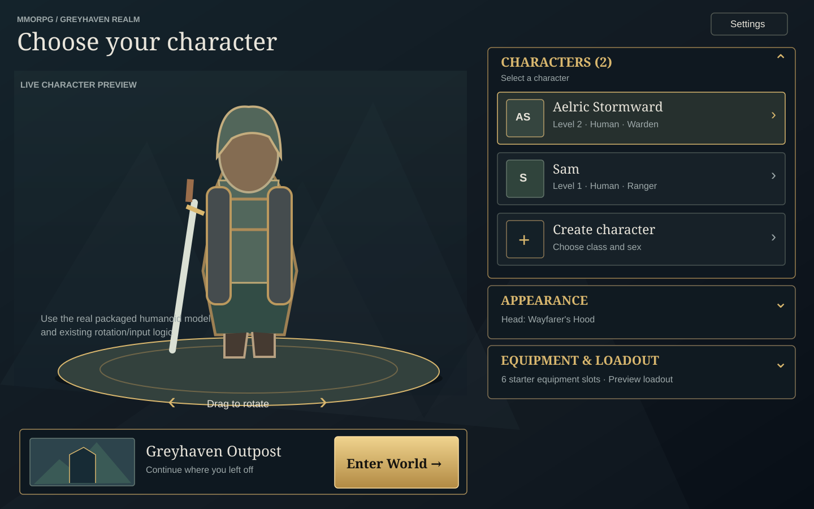

# Character selection — approved layout

Product decision: [Decision Atlas 6.4.4](decisions/atlas.md). This document specifies the user-visible character-selection layout; it does not change server authority, persistence contracts, or gameplay.

The schematic is the **structural reference**. The approved cinematic Greyhaven mockup defines the dark-fantasy atmosphere, restrained gold accents, readable contrast, and upgraded humanoid presentation. Illustrative concept artwork is **not** a shippable asset or proof that distinct class/sex models already exist.

## Desktop layout

- **Left / main:** Large real 3D character preview with existing drag, keyboard, left/right and reset rotation controls. The character and camera receive the space; explanatory chrome stays minimal.
- **Right / controls:** Three **independently collapsible** sections in order: **Characters**, **Appearance**, **Equipment & Loadout**. Each header is a real button with a visible chevron and accessible expanded state.
- **Below preview, left:** One compact continuation panel: last known area (e.g. **Greyhaven Outpost**), brief **Continue where you left off** text, and a prominent but not oversized **Enter World** button.
- **Secondary:** Retain functional **Settings** and development-only online-mode affordance without creating a competing large card.
- **Absent:** The **Selected character** card, **Destination** section, destination selector and **Choose where to enter the world** prompt.

The UI identifies the selected character through the highlighted roster row and actual 3D preview rather than repeating a large name card.

## Accordions and selection behavior

| Section | Initial | Expanded contents | Collapsed contents |
| --- | --- | --- | --- |
| Characters | Expanded | Roster rows (portrait or initials fallback, name, level/class), create-character action, existing status/error feedback | Header and optional count/selected-name summary |
| Appearance | Collapsed | Existing headwear choices and appearance-only save/load; immediate 3D preview update | Current appearance summary |
| Equipment & Loadout | Collapsed | Existing six-slot equipment preview moved from removed character-details card | Concise equipment summary |

A section-header click/tap toggles **only that section**. Collapse does not mutate character, appearance, equipment, saves, or preview yaw. Use a real disclosure element or a header button with aria-expanded, aria-controls, visible focus and keyboard operation. Keep relevant loading/errors announced; never intercept text editing or browser-reserved shortcuts.

Selecting a roster entry updates preview, appearance, equipment, resume label and Enter World target together. Character creation keeps the present form and rotating preview; the continuation action is hidden or disabled while creating a character. Do **not** display an inert Edit loadout control: the selection equipment view stays read-only until real editing is supported.

## Continuation, not destination choice

- **Enter World resumes the selected character at its saved location** through the existing zone-entry, character lease and restoration path. A first-time character uses the existing default spawn. The user cannot select a spawn location on this screen.
- The panel's area label is **read-only**, derived from committed character/area data when available, and never falsely hardcoded as Greyhaven Outpost for a character saved elsewhere. If location cannot be shown reliably, use a neutral continuation label.
- Preserve existing loading, disabled, error and online-development join behavior. The selection UI never writes authoritative location, introduces its own spawn selection or invents a second persistence model.
- Keep browser demo world and per-character checkpoints, cross-tab exclusion, and restore behavior described in [SAVE_LOAD.md](SAVE_LOAD.md). Keep creation in [CHARACTER_CREATION.md](CHARACTER_CREATION.md).
- Correct outdated selection text claiming world progress does not save.

## Real character preview / ownership

The selection preview in web/src/main.ts still constructs box, cylinder and sphere nodes; the in-world browser renderer already loads real skinned units with Three.js from web/src/world/units/quaternius-units.ts. Reuse the **existing approved packaged humanoid and loader/instance path** for the selection turntable. If necessary, extract only the narrow shared model-instantiation seam rather than duplicating a glTF parser, animation engine, asset manager or renderer. The render mesh/preview pose never affects gameplay authority.

Atlas 6.3.7 deliberately permits one Ranger humanoid across class/sex choices while other approved bundles are missing. **Newer models** means using the real existing asset in selection, not inventing or hardwiring unapproved class/sex variants. Update to the rolling bundle under [#272](https://github.com/moenarch-games/mmorpg/issues/272) only when adoption is actually required for this visible slice. Retain a deliberate loading/failure fallback; avoid additional upstream prerequisites.

Existing browser edit surfaces: web/index.html; web/src/main.ts; web/src/character-selection-layout.css and web/src/styles.css; character-selection, character-roster, character-customization, character-turntable, and the existing imported-unit path. Preserve stable IDs/semantics used by the current browser smoke tests. Native remains wgpu/winit; any later native-screen parity is separately reconciled, not implemented as a browser webview.

## Acceptance for the implementation issue

- Real browser screen reflects the two-column schematic with the approved mood, and displays an actual in-game humanoid instead of the primitive-only preview. Rotation visibly works.
- Characters start expanded, Appearance and Equipment collapsed; independently toggle by pointer and keyboard without changing character/saves. Switching characters updates correct preview and continuation target.
- Headwear choice and appearance save/load work; equipment preview is correct and read-only. Creation and Settings remain functional.
- **Enter World** resumes the existing saved character/location, or the existing first-entry spawn; no destination selection. Loading and errors remain honest.
- On desktop and mobile viewports, controls are reachable, focus is visible, and no horizontal overflow hides the primary action. Capture one real browser screenshot of the result.
- Extend a relevant existing regression path (web/tests/character-selection.test.mjs or scripts/smoke-browser.py), then use the narrow happy-path check mandated by AGENTS.md. No new test framework, extra ratchet or full-suite gate by default.
