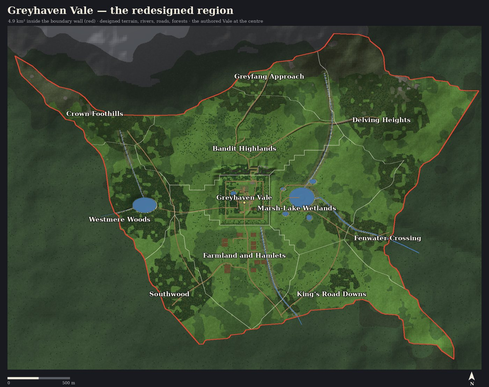

# The Greyhaven region

The Greyhaven zone covers the continent atlas's whole Greyhaven Vale region: about 3.7 km ×
2.6 km (4.9 km²) inside its boundary wall (#810, #812). This document is its design (#816,
Atlas 5.1.i816): one landscape instead of rectangles glued together.

## Why it was redesigned

The region grew in increments. The Vale, then the Farmland, Highlands and Wetlands, each a
rectangle with a straight ridge against the next, then the atlas's new ground round them. It read
as separate boxes:

- straight ridges and walls between the regions;
- grid roads, rectangular fields and forests;
- flat, empty ground;
- isolated grass tufts;
- paths that clipped through the ground.

## The geography

The Vale lies in a basin under the Crown mountains. The land rises north to the mountains and
falls away west and south. Two rivers drain it:

- **Greywater:** the village brook leaves the Vale south through the farmland and the King's Road
  Downs.
- **Fenwater:** the Marsh Lake drains east past a ford at Fenwater Crossing.

Mountain streams feed both basins:

- the **Delving Run** comes down a ravine from the Delving Heights into the Marsh Lake;
- the **Westmere Beck** fills **Westmere Tarn**, which overflows west.

| Sub-region | Character | Creatures (levels) |
| --- | --- | --- |
| Greyhaven Vale | The authored heart round the Outpost's basin, and the land round it | the quest chain's |
| Bandit Highlands | Greyfang Ridge and the uplands beyond its pass, rising to the mountains | Redbrand garrison (3–5) |
| Farmland and Hamlets | Rolling downs with three hamlets, hedgerow trees and the landmark tower | — |
| Marsh-Lake Wetlands | The marsh basin round the lake and pools, alder copses | lurkers, boars, wolves |
| Greyfang Approach | Pine slopes and scree under the mountains, the road north | Redbrand outriders (4–5) |
| Delving Heights | Rugged high ground round the Delving Run's ravine | Redbrand veterans (5), hill ogres |
| Fenwater Crossing | Meadows and alders along the river, the ford | field marauders (3), boars |
| King's Road Downs | Open downs with copses and a spinney by the Greywater | marauders (3), boars, rats |
| Southwood | Mixed oak, birch and pine wood | boars (1–2), wolves (2) |
| Westmere Woods | Dense pine wood round the tarn | wolf packs (2), boars, tarn lurkers (3) |
| Crown Foothills | Pine and boulder slopes in the north-west | wolf packs (2), a hill ogre |

Difficulty rises away from the Vale, on the existing creature templates.

## Roads

Every sub-region is on a road, and loops join them without passing through the Outpost:

- **King's Road:** from the South Road through the hamlets and down the Greywater's west bank to
  the southern edge, toward Millford. The hamlets' lanes branch off it.
- **Greyfang Road:** from the Redbrand camp at the Greyfang cave's north mouth, winding up
  through the **Highland Pass** (a saddle in Greyfang Ridge), past the stronghold (by the
  **Stronghold Way**) and the **Lookout Path**, north to the mountains.
- **Delving Track:** east from the lookout across the ravine to the Delving Heights.
- **Fen Road:** east from the top of the Millbrook Climb, south of the Marsh Lake and down the
  Fenwater to
  its ford. The **Marsh Trail** leads off it to the causeway.
- **Fenwater Link:** from the Fen Road south to the King's Road.
- **Westmere Road:** west from the top of the Wolfrun Climb to the tarn. The **Crown Track** leads off it
  north into the Crown Foothills.
- **Southwood Trail** and **Westwood Track:** from the south hamlet through Southwood and back
  north to the Westmere Road.

Roads are graded into the ground (see below), so their surface is smooth and they never clip it.
Where a road meets a river it fords it.

## How it is built

Only the Vale's **heart** is hand-authored: the Outpost's basin and the rim round it with
Millbrook Farm, Stillwater Lake and the Sunken Shrine, Redbrand Hollow and the Greyfang cave.
Its outline is the `heart` in `design.json`, rounded into curves and swollen outwards by up to
15 m in broad lobes (`greyhaven_vale::beyond_core`), so no straight edge or square ring is left
of the old rectangular core. The old outer valley ring, its square Vale Ring Road, the straight
escarpment and its right-angled pass, and the farmland's and wetlands' ridges are gone.
Everything round the heart comes from committed data:

- **`content/greyhaven/design.json`** holds the design, in metres:
  - height controls and roughness;
  - the lakes and rivers;
  - the roads;
  - the forests (outline, species, spacing and cover);
  - the rock fields.
- **`content/greyhaven/authoring/region_design.py`** turns the controls, roughness, lakes and
  rivers into the macro terrain, **`content/greyhaven/terrain.json`** (16 m samples). It blends
  the controls over the atlas base terrain and adds three kinds of relief: rolling hills,
  walking-scale knolls and crags that grow with height. It also cuts each river's valley so the
  river never runs uphill. `--check` reports when the committed terrain is stale.
- **The zone** (`greyhaven_vale::design`, `zone_ground`) builds its 4 m ground from these layers:
  - the macro terrain;
  - the river channels, cut at the 4 m grid and filled with water reaches;
  - level pads under the yards, fields and buildings (buildings in a yard share its height);
  - the wetlands' own waters, island and causeway;
  - the roads, each graded to a smoothed profile along it except at fords; a branch eases onto
    the height of the road it leaves.

  Within 40 m of the heart this blends into the authored ground.
- **Forests and rock fields** are colliders: trunks and boulders, kept clear of roads, waters,
  pads, creature posts and each other. The clients draw the ground cover from the land itself:
  - forest floor under the closer forests;
  - damp hollows by the rivers and the marsh;
  - rock on cliffs, highland grass high up;
  - meadow in broad patches;
  - undergrowth clumps in and along the forests;
  - tussocks, flower drifts and scrub gathered in patches across the open land.

  The heart's own woods and groves are rounded into clumps. Beyond the wall the mountains are
  wooded low down, with crags, rock and snow above.

East of the Downs Copse, the **Eastdown** meadow (#872) is open pasture rising to the zone's
south-eastern crest. Its design gives the slope a knoll, a damp dell and a shoulder (three
`controls`), a hilltop crown of trees, a copse, a dell thicket, a broken hedgerow and a lone oak
(five small `forests`, appended so earlier trunks keep their IDs). The world dressing
(`dressing/eastdown.json`) adds a cairn on the knoll and a rock scar with talus where the
shoulder breaks, from the crag kit, with collision generated from the art. Review pose
`eastdown` in `scripts/review-poses.json` shows it from the Downs' edge
([before/after](reviews/eastdown-meadow/)).

## Settlements and landmarks

The roads lead to places (#818, `greyhaven_vale::settlements`). Each is a named area inside its
sub-region (it names the ground it stands on), its yard is a level pad of the designed land, and
its buildings reuse the Vale's visuals:

| Place | Where | What stands there |
| --- | --- | --- |
| Barrowdown | A knoll of the King's Road Downs, off the Fenwater Link by Barrowdown Lane | Three houses, the Barrow Rest alehouse, a barn, a well, a waystone |
| Barrowdown Ring | West of the hamlet | Eight standing stones round an old barrow |
| Fenford | North of the Fenwater's ford, up Fenford Lane from the Fen Road | Three houses, the Ford Inn, a mill, a well, a waystone |
| Westmere Lodge | Westmere Tarn's eastern shore, at the Westmere Road's end | The fisher's lodge, a tent and fire, a waystone |
| Hunters' Camp | On the Southwood Trail | A lodge, tents, a fire and drying racks |
| Delving Workings | At the Delving Track's end | A mine mouth in the rock, a watchtower, a camp; the Redbrands hold it |
| Greyfang Watch | Beside the Greyfang Road below the mountains | A tall watchtower and a fire |
| Crown Stones | Beside the Crown Track | A ring of eight standing stones |
| Delving Run footbridge | Where the Delving Track crosses the Delving Run | A 9 m plank footbridge on trestles (#828), asset-tooling's `settlement.props.footbridge` (asset-tooling#651); players walk its deck, end ramps and between its rails |

Barrowdown, Fenford and Westmere Lodge hold the network's fourth to sixth waystones, so a
traveller who has found them can return there from the Outpost's stone.

## People and their days

Greyhaven's people keep a day (#819, `greyhaven_vale::residents`). Each works at its post by day,
walks home at dusk (20:00) and back at dawn (06:00), and runs errands at set hours: out along an
authored path, a while at the far end, then back to work (`mmorpg_core::Errand`).
Where a resident is is a pure function of the zone's tick, so it needs no saved state and replays
exactly.

Residents carry what their day calls for (#904, presentation only): `content/greyhaven/chores.json`
maps each resident's work and errands, and every walk home or back, to a `humanoid-equipment` item
on a figure socket with its chore or carry clips (a lantern on the walks, a bucket to the well, a
tankard at the inn, a sack or crate against the chest). `mmorpg_presentation::units::chores` picks
the chore from the routine and the zone clock, and both clients draw the item; a missing item or
clip leaves the hands empty.

- **The Outpost's residents** live in the houses round the square. The weaver, the fisher and the
  baker fetch water at the well, Davin and the peddler call at the inn, the porter waits for loads
  at the north and east gates, the washer works at the brook below the bridge, the peddler greets
  travellers at the south gate, the herbalist gathers along the South Road each morning and the
  miller spends his working day at Millbrook Farm's windmill.
- **Barrowdown:** Gwen Barrow keeps the Barrow Rest, Shepherd Corin and Farmer Tobin Hale take
  their midday ale there, Old Maud keeps watch at the barrow ring, and Pip runs to the stones in
  the morning and to the alehouse in the afternoon.
- **Fenford:** Hob Ferris keeps the Ford Inn, Miller Wynne works the mill, Ferryman Osk waits at
  the ford, Netter Ilsa mends nets in the square, and Trader Maren keeps a stall with the
  region's gear by day (#826): padded armour, the buckler and shortsword, and the level 6 mace,
  jerkin and cowl.
- **Westmere Lodge:** Fisher Brann fishes the tarn and eats at the fire at noon.
- **The hunters' camp:** Huntsman Edric Vale keeps the fire; Trapper Sela walks her lines in
  Southwood each morning.
- **Greyfang Watch:** Watchman Garth holds the tower, Watchman Pell walks the road north twice a
  day.
- **The farmland's hamlets:** Goodwife Ena, Ploughman Garr, Old Bertil, Shepherd Lise, Miller
  Hanne and Farmhand Jory work their fields, wells and mills.

## Quests

Twenty quests carry players from the Vale's chain out into the region (#820, #859,
`content/greyhaven/quests.json`). The Marshal starts three chains, each through one or two
settlements, and Farmer Osric Mill a fourth through the farmland's hamlets:

| Chain | Starts | Giver | Quests |
| --- | --- | --- | --- |
| The Downs and the ford | After *Trouble in the Woods* | Gwen Barrow at Barrowdown, then Hob Ferris at Fenford | *Word from the Downs*, *Raiders on the Downs*, *Grain for the Barrow Rest* (stolen grain sacks from marauders), *The Barrow Ring* (hear out Old Maud), *Down to the Ford*, *Tusks and Tallow* (boar tusks), *The Fenwater Raiders* |
| The tarn and Southwood | After *Scout the Lake* | Brann at Westmere Lodge, then Edric Vale at the hunters' camp | *The Lodge on the Tarn*, *Scales of Westmere* (lurker scales), *Wolves at the Water*, *The Hunters' Camp*, *Southwood Hunt* |
| The Greyfang Road | After *Garrick Redbrand* | Watchman Garth at Greyfang Watch | *The Greyfang Watch*, *Orders on the Road* (crossbowmen's orders), *The Delving Workings* (retake the mine camp), *Ogres of the Heights* |
| The hamlets | After *Marauders in the Fields* | Farmer Osric Mill, then Goodwife Ena, Miller Hanne and Shepherd Lise | *The Hamlets*, *Rats in the Granary* (grain rats about the western barn), *Boars in the Barley* (boars west of the southern hamlet), *The Shepherd's Wolves* (a pack east of the eastern pastures) |

The hamlets' rats, boars and wolves (`greyhaven_vale::hamlet_creatures`, spawns 1400–1411) stand
clear of the hamlets' buildings, fields, roads and residents' ways. The quests themselves are
content in `content/greyhaven/quests.json` (#862); a new chain adds entries there, with no fixed cap
on quests or quest NPCs beyond the quest sheet's packet budget.

The four quest items (boar tusks, grain sacks, lurker scales and Redbrand orders) drop only while a
quest needs them. Rewards are experience, copper and the Vale's existing gear.

Review the Downs chain with `?scenario=greyhaven-downs`: a level 4 Warden on Barrowdown Lane with
*Trouble in the Woods* turned in and *Word from the Downs* accepted, a few steps from Gwen Barrow.

## Grass and houses

Grass grows as blades, not tufts (#832). `mmorpg_presentation::grass` decides where: thickly on
meadow and foothills, thinner on the hub, hollows and highland, sparse under woods, and nowhere the
near terrain's overlays (forest floor, gravel, mud, sand, paths, rock) or its worn roads, plaza and
fields cover the turf, nor in water, river beds, terrain holes or the footprint of anything that
stands on the ground. Each clump takes the ground's tone, leaning greener, with paler dry patches
over about 18 m. It lays out 8 m cells on a jittered lattice about 0.3 m apart; a cell's clumps
come in a random order, so any prefix is an even thinning. The browser draws the field by the
**World detail** graphics setting (`graphics.world_detail`): **low** draws no grass (nor the ambient
creatures, nor the light of lamps and fires); **medium**
(the default) draws 60 % of the clumps within 6 m of the eye, thinning out to 30 m; **high** draws
them all within 10 m, thinning out to 44 m. Each clump thins out on its own (#845): once its
distance's share falls below its rank in its cell's random order it dissolves in a screen-door dither
at its full height (#871), so no line shows where the field thins and nothing grows from or sinks
into the ground as the eye moves. Every blade has its own shade and hue; with distance blades lose
their root-to-tip shading and take their clump's flat colour, about the turf's own tone, so the
thinning field melts into the ground rather than leaving dark tufts on it. Clumps within about 9 m (medium) or 13 m (high), jittered by 3 m per
clump, are 15 thin, tapered, curved blades of five triangles; further ones are 7 wider blades of
three, sharing the same instances. Beyond the near field a far field of sparse, wide clumps of eight
narrow single-triangle blades (`Grass::far_cell`, 32 m cells about a metre apart, with larger flower
heads) grows in as the near one thins and reaches 70 m (medium) or 100 m (high). The wind bends
them and the player's feet push them aside in the vertex stage.
Wildflowers grow in drifts of one colour over several metres on thick turf (buttercup, daisy,
harebell and poppy, `grass::FLOWERS`): a flowering clump also draws four small plants rising to
about its blade tips (#868), each a bowed stem and leaf in the clump's green under a cupped head of
five or six rounded petals round a warm heart, every head its own size, spin and tilt and every plant
its own turn, spread and height, thinned with the grass. Like a blade clump a plant keeps its height and dissolves in a
screen-door dither as it thins, so heads do not rise and fall as the eye nears. Under the woods, heart and designed forests alike, the ground is
the forest floor's leaf litter, its texture turned about 35° off the grid and repeating every 4.5 m
so it does not read as stripes. The old procedural tufts draw nothing; the native client has no
grass field yet.

The region's sixteen 8 × 6 m houses, the settlements' seven (#843) and the farmland hamlets' nine
(#847), are walk-in cottages: the Outpost's timber-framed house in asset-tooling's Outpost kit, its
doorway open and turned to its settlement's yard or its hamlet's lane, with a bed, a
hearth, a table and chair and a chest from `settlement.props` on a packed-earth floor
(`content/greyhaven/dressing/settlements.json`, written by `cargo run -p mmorpg-scenery --example
export-settlement-dressing`). In the zone (`greyhaven_vale::cottages`) each is the kit's walls round
the doorway and its furniture, not one box; its floor stands on the footprint's lowest corner, so
on a slope the ground inside rises a little but never to the lintel. Eleven residents walk in at dusk, round the house to the
door and through the room, to the bed, or for a cottage's second resident to the hearth. While the
viewer is inside, both clients lift the cottage's roof (`outpost_kit::cottage_roofs`), pull the
camera in before its walls and light a lamp in the room (`buildings::Spec::cottage`).
The six 8 × 7 m farmhouses (#886), the Barrow Rest, the Ford Inn, Millbrook's and the three
hamlets', are the Outpost kit's two-room farmhouse (`cottages::Plan::Farmhouse`): its front doorway
and the partition's doorway open, a hall with the hearth on its gable, a table between two benches,
firewood and a barrel, and a chamber behind with the bed and a chest, placed clear of the walk
through both doorways (`clear-spot --indoors`). Their residents, the farmer, the alewife, the
innkeeper, the goodwife, Old Bertil and the farmhand, walk through the hall to the bed at dusk.
Millbrook's farmhouse is no longer part of the authored fortifications (`fortifications.py`).
Westmere Lodge's larger hall, the barns and the inn keep the Vale's procedural buildings.

The villages carry asset-tooling's everyday `settlement.props` (#851). The settlements' and hamlets'
wells, barrels, crates and carts and the two stone rings' stones are drawn as the kit's well,
barrel, crate, cart and carved standing stone over their unchanged boxes (the boxes draw again if the
bundle fails). Solid new clutter stands by the barns, houses and camps
(`greyhaven_vale::village_props`, colliding as each prop's descriptor proxies): haystacks and hay bales
by every barn, grain sacks by the windmills, washing lines between cottages, vegetable beds, kennels
by the dogs' rounds, a wheelbarrow, chopping blocks at Westmere Lodge and the hunters' camp, and the
inn's barrels and the lodge's crates, each on clear ground off roads, fields, shores and every
resident's way.

A second batch dresses the places with their trades (#891, `village_props::SETTLEMENT_PROPS`):
apples, bread and cheese on the Outpost's stalls and a fish crate on the third; cloth, pottery and a
butcher's rack by it on the brook's bank; the smithy's forge behind it and the smith's, tailor's and
baker's swinging signs (with the tailor's loom); the tannery's hide frames west of the tanner's post;
banners at the south gate; the Greyhaven inn's sign, cask rack, jar shelf, dresser, settle by the
hearth, rug, candles and candelabrum and a shield on its wall; Millbrook's watermill and a water wheel
on the village brook; a scarecrow, troughs, the barn's vane, a hen coop, skeps and a churn at
Millbrook Farm; a post mill on Barrowdown's knoll, bunting and a market day's awning stall, scale and
potter's wheel on its green, its barn's vane and the Barrow Rest's sign, casks, rug and candles; the
Ford Inn's sign, bar counter and candles and a banner at Fenford; scarecrows and a plough in the
hamlets' fields; a spit and a hide frame at the hunters' camp; and at Westmere Lodge a windlass over a
bare curb, drying nets, a jetty and a moored rowing boat on the tarn. Each collides as its descriptor
proxies (the windlass also as its curb; a rug, walked over, not at all). Props on a table, a counter,
a wall bracket, an inn's floor or the water stand on an explicit floor and leave the ground's relief
alone. Both clients loop the props' node clips (the mill wheels and sails, the forge's bellows, the
windlass, the spit, the potter's wheel, the signs, the vanes and the scarecrows' hats and sleeves) on
the presentation clock, holding the first pose under reduced motion, and the forge and the spit glow
with a warm flickering light. A placement check (`settlement_props_stand_clear_of_colliders_and_residents`)
keeps every proxy off other colliders and every resident's way.

## Gathering and the smith (#917)

Three iron ore veins stand in the rock at the foot of the basin's north buttress, a short walk north of the Outpost: one gather (interact in reach) takes a vein's two ore and spends it for everyone for two minutes, its spent look swapped in place in both clients. Any boar corpse a player may loot can be skinned once (interact with it selected) for a hide and a tusk. Smith Wulfric Hale, in the yard behind the Outpost smithy by his bench, sells one recipe through his vendor window: the Hollowpine Boar-Spear for 4 ore, 2 hides, 2 tusks and 20 copper (Atlas 5.3.16.i917). Veins and bench are world dressing (`content/greyhaven/dressing/gatherables.json`, colliders 65180–65183).

## Not yet done

- **More homes you can enter:** the Outpost's three kit houses and
  Westmere Lodge's hall are still solid; their residents end their day on the doorstep.
- **The basin's climbs' ground:** the six ways up the heart's 11 m cliffs are still straight ledges
  cut into the cliff; only their roads round their turns (every authored road turns on a 4 m curve).
- **Visual acceptance** from the owner.
