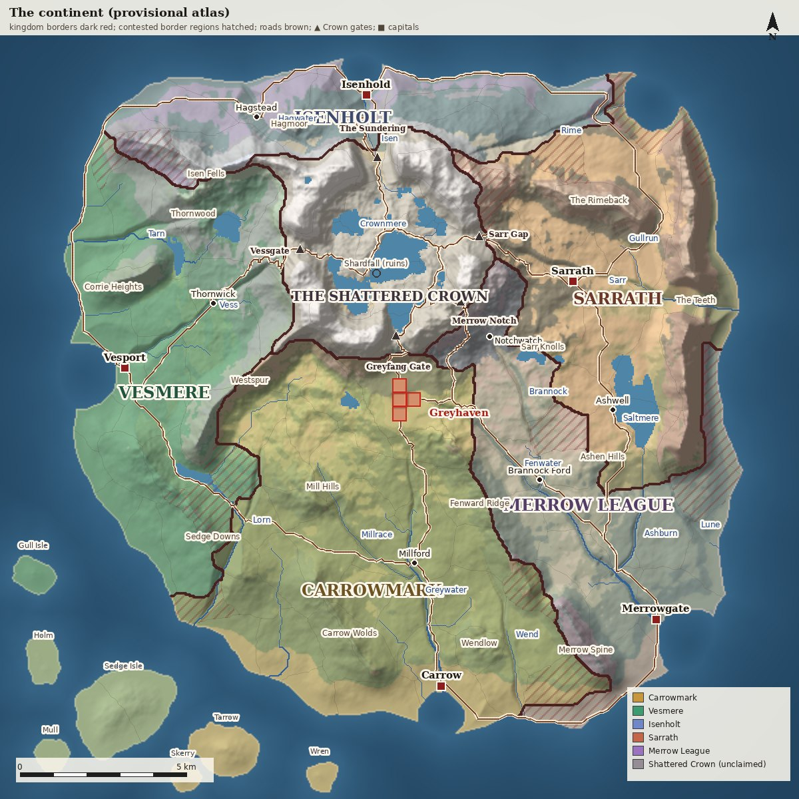
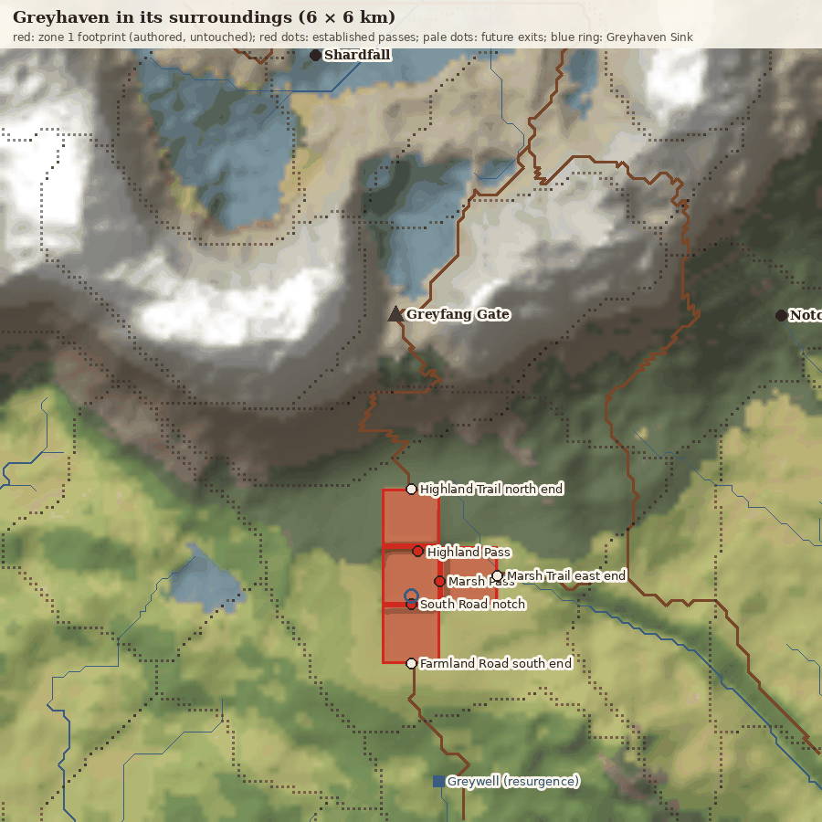
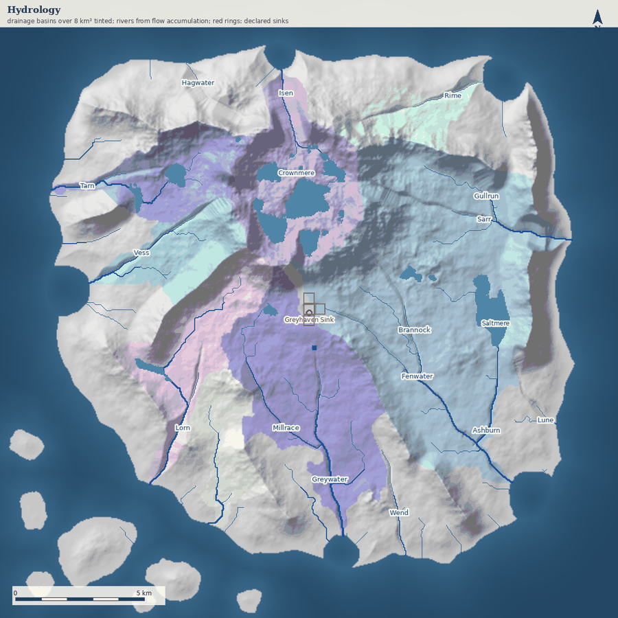
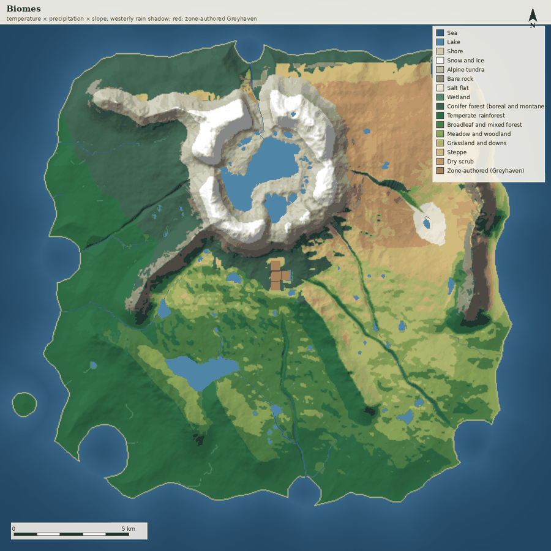
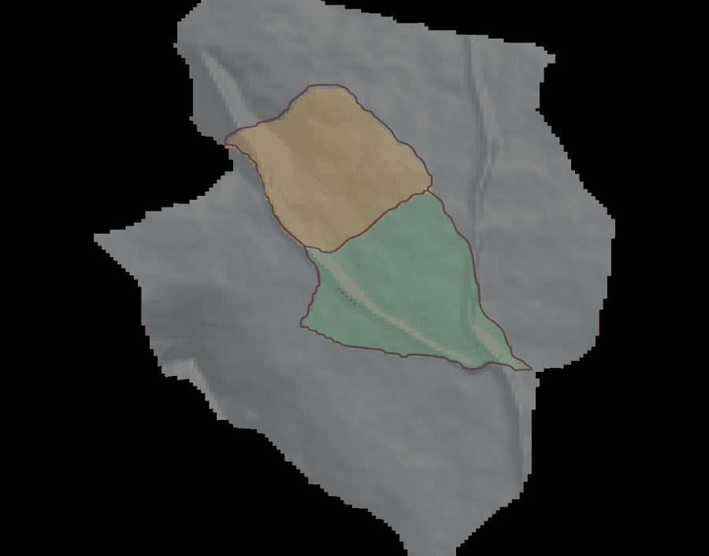
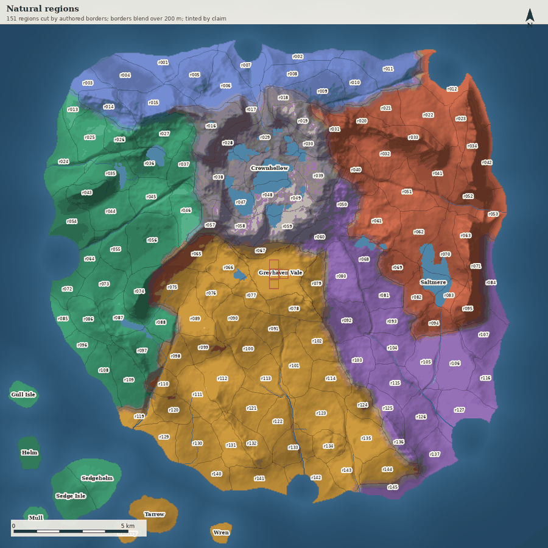
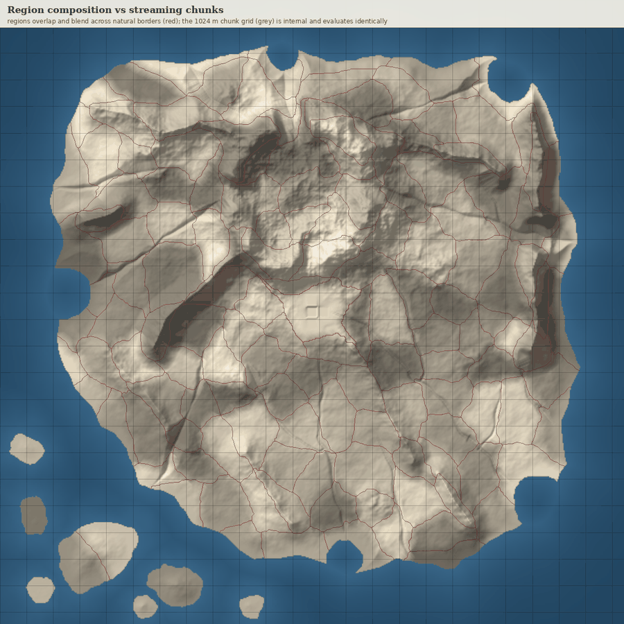

# Continent atlas

A provisional, editable geographic foundation for the whole world: one continent of about
20 × 20 km around Greyhaven, the Shattered Crown and five competing kingdoms. It is
**development tooling and design data only**: no game crate, host, client or content revision
reads `content/world/` yet, and Greyhaven's zone content stays the authority for everything
inside its footprint. Progress, open gaps and how to resume are in
[WORLD_ATLAS_HANDOFF.md](WORLD_ATLAS_HANDOFF.md).



```sh
uv run content/world/authoring/atlas.py check --previews docs/images/world   # build, render, verify (about 1 min)
uv run content/world/authoring/atlas.py build                               # outputs only, in artifacts/world-atlas/
uv run content/world/authoring/atlas.py seed-regions                        # append seeds for uncovered land (each then needs a border)
uv run content/world/authoring/atlas.py format                              # canonical JSON layout
blender --python content/world/authoring/atlas_blender.py -- region r100 r113   # Blender file for two neighbouring regions
blender --python content/world/authoring/atlas_blender.py -- import         # editable Blender scene
blender --background artifacts/world-atlas/continent.blend --python content/world/authoring/atlas_blender.py -- export
```

`uv` resolves the generator's two dependencies (numpy, Pillow) from the script header. Blender
5.2.2 LTS is optional, as for the Outpost layout bridge (`scripts/dev-blender.sh`).

## Constraints: established versus provisional

| Established (repository facts the atlas obeys) | Source |
| --- | --- |
| 1 m = 100 sim units, Y up, **−Z is north**, Greyhaven Outpost centre is (0, 0) | `docs/STARTER_ZONE.md`, `greyhaven_vale.rs` |
| Greyhaven zone 1 footprint: Vale x ±208, z ±208 m; Bandit Highlands north (z −632..−208, ~24–56 m above the Vale floor); Farmland and Hamlets south (z 208..640, +8 m); Marsh-Lake Wetlands east (x 208..632, +4 m) | `greyhaven_vale.rs`, Atlas 5.1.i424–i426 |
| The Vale is a sheltered crater-like valley with cliffs and terraces; a brook from the western rim leaves the Outpost south through the palisade | Atlas 5.1.84, 5.1.i513 |
| Established entrances: Highland Pass (north), Marsh Pass (east), the South Road notch (south); mountains beyond the walls are scenery | `STARTER_ZONE.md` |
| Harsher, dangerous highlands north; settled, gentler farmland south; wetlands east | Atlas 5.1.85 |
| Crossings between major regions are continuous physical passes without loading screens; authority boundaries use fenced seam corridors | Atlas 5.1.86, ADR 0007 |
| Fast travel only between hubs first reached on foot | Atlas 5.1.9 |
| Run speed 6.3 m/s (`RUN_SPEED_UNITS_PER_SECOND = 630`) | `mmorpg-core` |
| Owner direction (2026-11-10): continent about 20 × 20 km; regions about 2–4 km², about 150 of them | this task |

Everything else here is **provisional**: the Crown's shape and the meaning of its name, the
gates, kingdom names, borders and capitals, rivers, climate and every name not listed above.
The repository records no prior lore for the Shattered Crown or the kingdoms; the
interpretation below (Greyhaven's three passes are the established southern approaches to
the Crown) is the atlas's assumption, flagged as Question 1.

## Scale

The domain is 24 × 24 km on a 40 m grid with Greyhaven's own frame, so atlas metres are zone
metres. The continent covers about 334 km² of land, roughly 20 km across in both directions,
plus 13 km² in seven offshore isles: a coast-to-coast walk is about 55 minutes at running
speed, comparable to a large MMO continent. At that size it is treated like a small Europe:
several mountain systems, hill countries and river basins with distinct European landscapes
rather than one massif in a plain, and no landscapes from outside Europe such as deserts. Elevations are compressed for play (the Crown's crest is about 1,150 m), so the
climate model uses an exaggerated 10 °C/km lapse rate to put snow on it.

## Arrangements considered

| Arrangement | Coherence | Play | Fit with Greyhaven | Verdict |
| --- | --- | --- | --- | --- |
| **A. Ring massif at the centre**: the Crown is an eroded structural dome, a resistant rock ring around a worn-out core, its crest broken by five gaps ("gates"); kingdoms radiate around it, rivers drain radially | Eroded domes with hogback rings, radial drainage and limestone aprons are well attested (the Black Hills are the model); one wind gives a wet west and a rain-shadowed east | Every kingdom borders the contested heartland through its own gate; difficulty rises toward the centre; trade circles the ring | Greyhaven sits on the southern apron below the Greyfang Gate: highlands rise north into the Crown, farmland falls south | **Selected** |
| B. Spine cordillera dividing west from east | Strong orographic contrast | Two coasts, few chokepoint passes; a long linear world | Fits only if Greyhaven is a pass basin in the spine | Kept as alternative |
| C. Kingdoms around an inland sea, the Crown a broken northern arc | Plausible | Sea travel dominates; land routes are thin | Greyhaven would be a northern backwater | Kept as alternative |
| D. Crown peninsula: mountains in one corner, lowland kingdoms elsewhere | Plausible | The Crown is a cul-de-sac; kingdoms compete mainly with each other | Greyhaven at the edge of play | Rejected |

A fits the established Greyhaven facts best and gives the clearest gameplay structure:
levelling outward from Greyhaven and inward toward the Crown, five gates as contested
chokepoints, and a natural reason for five rival powers to meet. The alternatives can be
rebuilt from the same layers by moving the `crown` and `ridges` controls.

## The selected geography

**The Shattered Crown.** An eroded structural dome about 14 km across. A ring of resistant,
upturned rock forms the crest (radius 2.7 km, about 1,150 m) around Crownhollow, a basin
worn into the softer core that holds Crownmere. Outside the ring, the dome's flanks are a
limestone apron, which is why karst appears at Greyhaven. Five gaps break the ring, one facing
each kingdom:

- The Greyfang Gate faces south, toward Greyhaven.
- The Sundering faces north. It is the only water gap: Crownmere drains out through it as the Isen.
- Vessgate faces west, Sarr Gap east and Merrow Notch south-east.

The four gates other than the Sundering are wind gaps 150–250 m above the crater floor:
former spillways that now carry roads rather than rivers. The interior is unclaimed,
high-level ground with the ruins of Shardfall.

**Greyhaven.** The Vale is read as a **small karst polje** (uvala-sized): a closed,
flat-floored basin in the limestone apron with steep walls, drained underground. The atlas sends the Outpost's brook into
a ponor (Greyhaven Sink) just south of the palisade, and it resurfaces 1.5 km south at the
Greywell, the source of the Greywater. This explains the basin's lack of a surface outlet without
touching zone content. Atlas 5.1.i513 says the zone itself has no hydrology; the ponor exists
only in the atlas (Question 5). The anchor models the zone's ridges between the Vale and its
outer regions, and each part declares where it drains: the Vale to the ponor, the Farmland and
Hamlets to the Greywater, and the Marsh-Lake Wetlands to the Fenwater. The checks follow the
derived flow and confirm each outlet. Roads leave the footprint only at its declared exits:

- The Highland Trail's north end leads up the apron to the Greyfang Gate.
- The Farmland Road's south end continues to Millford and the King's Road.
- The Marsh Trail's east end follows the Fenwater toward the Merrow delta.



**Ranges and hill country.** Around the Crown, the main European mountain types:

| Range | Where | Model | Character |
| --- | --- | --- | --- |
| Isen Fells, Hagmoor | North-west | Scandinavian fells | Bare heath and tundra tops above taiga |
| The Rimeback | North-east | Scandinavian fells | A long range between the Rime and the Sarr |
| Corrie Heights, Thornwood | West | Scottish Highlands | A wet coastal range with moorland hills behind it |
| Westspur | South-west of the Crown | A Pyrenean spur | Divides Vesmere from Carrowmark |
| The Teeth | East coast | Dinaric and Carpathian | The highest coastal range. The Sarr breaks through it in the Iron Throat gorge (the Iron Gates) |
| Merrow Spine | South-east | Apennine | Steep and rocky, toward the Merrow coast |
| Fenward Ridge, Carrow Wolds, Sedge Downs | South and west | English downs and wolds | Low chalk ridges |

Six hill countries are rolling uplands of rounded summits rather than ranges, after the
German *Mittelgebirge*: Thornwood, Hagmoor, the Mill Hills, the Sarr Knolls, the Ashen Hills
and Wendlow. The south-west coast is cut back into an Atlantic archipelago of seven isles:
Gull Isle, Holm, Mull, Sedge Isle, Tarrow, Skerry and Wren. The four western isles belong to
Vesmere and the three southern ones to Carrowmark.

**Water.** Fifteen authored rivers have strictly falling beds and meander deterministically:

| Basin | Rivers |
| --- | --- |
| South | The Greywater with the Millrace, the Fenwater with the Brannock and the Ashburn, and the Wend |
| West | The Lorn, the Vess and the Tarn |
| North | The Hagwater, the Isen and the Rime |
| East | The Sarr with the Gullrun, and the Lune |

Each bed starts at the ground at its head and deepens downstream, so headwaters do not cut
canyons and the gates keep their authored floors. Tributaries are carved before their main
river, so the main river cuts below them. Each tributary runs on to the main river's actual
meandering course, so no dam is left at the confluence. Everything else is derived: flow
routing on a depression-filled surface, natural lakes, and one declared sink, the Greyhaven
ponor.

Hollows shallower than 18 m silt up into flats that drain, so the noise leaves no scatter of
ponds. Deeper basins and declared lakes keep their water. The declared lakes are Crownmere and
Saltmere, a shallow reed lake on the Sarrath plain (after the Neusiedler See) in place of the
earlier salt pan. Two derived lakes still deserve review before they are named: a deep tarn
just inside the Greyfang Gate on the road to Shardfall, and a lake in western Carrowmark.



**Climate and vegetation.** The climate draws on Europe only. Westerlies bring most of the
rain, with a weaker southern sea wind and a weak easterly from the eastern sea, so the far
east is not a desert. Rain falls on the windward west and the Crown's west flank. The shadow
scales with how far the air has sunk below the highest ground upwind, so low ridges cast only
short, faint shadows. Like the lapse rate, the north–south temperature spread (6 to 17.5 °C
over 24 km) is stylised.

| Area | Vegetation | Model |
| --- | --- | --- |
| Wet, cool north-west tops | Heath and moorland | Atlantic |
| Cold north | Taiga | Scandinavian |
| The Crown | Alpine tundra and snow | Alpine |
| Wettest west coast | Temperate rainforest | Celtic rainforest |
| Centre and south | Broadleaf forest, meadow and downs | Temperate Europe |
| Warm south coast and the isles | Maquis and evergreen oak | Mediterranean |
| Sarrath, in the Crown's lee | Steppe grassland | Pannonian puszta |

Greyhaven sits among montane conifer and mixed woods, consistent with Wolfrun Woods,
Hollowpine Reach and the highland pines.



**Kingdoms (provisional).** Kingdoms claim whole regions by terrain-weighted travel cost from
their capital and towns; the Crown is unclaimed, and border regions within 18 % of a rival's
cost are marked contested.

| Kingdom | Character | Capital | Gate | Regions, area |
| --- | --- | --- | --- | --- |
| Carrowmark | Grain and river plain of the south and the southern isles; Greyhaven is its northern march fort | Carrow | Greyfang Gate | 43, 95 km² |
| Vesmere | Wet west coast and the outer isles: timber, ships, heath, fisheries | Vesport | Vessgate | 32, 71 km² |
| Isenholt | Cold northern fells and firths: iron, furs | Isenhold | The Sundering | 15, 37 km² |
| Sarrath | Grass plains in the Crown's lee: horses, the Saltmere, vineyards on the Teeth | Sarrath | Sarr Gap | 25, 57 km² |
| Merrow League | Delta merchant towns holding the Fenwater and the sea lanes | Merrowgate | Merrow Notch | 21, 52 km² |

The Crown itself is 15 unclaimed regions, 35 km².

**Settlement and trade geography.** Capitals stand at river mouths and on rivers; towns at fords
and route junctions (Millford, Brannock Ford, Thornwick, Hagstead, Ashwell); forts at
approaches (Notchwatch). Eleven roads are routed over the terrain between them, crossing large
rivers only where they must. Every gate is reached by a road from its kingdom that continues to
Shardfall in Crownhollow, and the Salt Road links Isenholt, Sarrath and the Merrow League across
the eastern plains.

## Natural regions

Regions are the unit of play and claims. There are 151, with a median of 2.3 km² and a range of
0.7–4.9 km²; 89 lie strictly within the 2–4 km² target, and most of the rest are smaller
coastal, island or Crown regions.
**Regions are puzzle pieces cut by authored borders.** `borders.json` holds every border once,
as a smooth line shared by exactly two regions. Each border ends at a junction where three or
more regions meet, or runs on past the coast. A region is the piece of land its borders cut
out, and its seed in `regions.json` gives the piece its id. So neighbouring regions fit
together by construction, and changing a border changes both regions at once.

The borders were traced once (`atlas.py borders`) from regions grown from their seeds by
terrain-weighted travel cost, so they fall on ridges, large rivers and steep ground. The
trace was then rounded with a majority filter, smoothed, and junctions closer than 150 m were
merged. From now on the borders are the source. Growing from seeds is only the bootstrap,
and retracing needs `--replace`.

**One Blender file per region.** Each region gets its own working file:

- its terrain piece (40 m cells that share corner heights with the next piece);
- its borders and junctions, draped over the ground;
- its seed;
- the surrounding regions, greyed, for context.

```sh
blender --python content/world/authoring/atlas_blender.py -- region r100 r113   # two neighbours in one file
blender --background --python content/world/authoring/atlas_blender.py -- all-regions   # a file per region, ~15 s
blender --background artifacts/world-atlas/regions/r100+r113.blend --python content/world/authoring/atlas_blender.py -- export
```

To change a border:

1. Open the two regions it separates.
2. Reshape or redraw its curve, keeping one spline per border.
3. Export. To move a meeting point, move its junction instead; every border ending there
   follows, including borders of regions not in the file.

Like every `.blend` in this repository, these files are generated, disposable and never
committed: the JSON is the source. Export writes only what the file changed. It refuses when
the same border was changed from another file since this one was made, so an old file never
undoes a newer edit.

The terrain pieces show the borders at the atlas's 40 m resolution. A zone opened later refines
the same line at its own resolution.



Neighbouring regions **overlap**: within 200 m of a border each point carries a secondary
region and blend weight, so presentation can compose continuous transitions. The 1,024 m
streaming chunks are internal only. Composing the blend needs only a chunk's own labels plus a
200 m halo. A check recomputes the blend for all 576 chunks this way and confirms each
matches the whole-world result exactly.
Greyhaven's region contains the whole zone footprint (4.8 km²), leaving room for the threefold
expansion already decided (Atlas 5.1.22).

 

The per-region adjacency table (kingdom, area, elevation, biomes, and each neighbour with its
border length and crossing kind: open, ridge, pass or river) is generated as
`artifacts/world-atlas/adjacency.md` and `atlas-report.json`.

**Macro adjacency plan.**

| From | To | Natural crossing |
| --- | --- | --- |
| Greyhaven | Crownhollow | Highland Pass, then the Greyfang Gate gorge |
| Greyhaven | Carrowmark heartland | Farmland Road, then the Greywater valley (King's Road) |
| Greyhaven | Merrow League | Marsh Trail, then down the Fenwater (Fen Road) |
| Carrowmark | Vesmere | Gap between Westspur and the Sedge Downs (West Road) |
| Carrowmark | Merrow League | Fenward Ridge and the South Coast Road |
| Vesmere | Isenholt | Coastal lowland west of the Isen Fells (North Road) |
| Isenholt | Sarrath | North coast (Salt Road) |
| Sarrath | Merrow League | Grass plains west of the Teeth, past the Saltmere (Salt Road via Ashwell) |
| Each kingdom | Crownhollow | Its own gate gorge |

## Authoring layers

All sources are JSON in `content/world/`, applied in a fixed order. Each is hand-editable,
and the generator never writes any of them.

| Order | Layer | Holds | Edited by |
| --- | --- | --- | --- |
| 1 | `terrain.json` | Coast control polygon, seas, islands, the Crown, ridges (ranges), uplands (hill country), noise | Hand or Blender |
| 2 | `water.json` | Major rivers, lakes to expect, sinks, springs, carving, silting | Hand or Blender |
| 3 | `overrides/height.json` | Sparse elevation deltas per atlas cell | Hand |
| 4 | `anchors.json` | Hand-authored places the atlas fits around (Greyhaven), with stand-in elevations and entrances | Hand |
| 5 | `climate.json` | Wind, temperature, rain model, biome rules | Hand |
| 6 | `overrides/biome.json` | Sparse biome overrides per atlas cell | Hand |
| 7 | `regions.json` | Region seeds; ids are stable | Hand, Blender, or `seed-regions`, which only appends |
| 8 | `borders.json` | Region borders shared by two regions each, and their junctions | Hand or Blender (per-region files) |
| 9 | `polities.json` | Kingdoms, pinned claims, settlements, routes | Hand or Blender |

The preservation rules:

- **Anchors win over everything.** The footprint is restored after the height overrides and
  re-marked after the biome overrides. Rivers never cut into it, and roads end at its exits.
- **Overrides are separate files** with the same `[column, row, value]` shape as Greyhaven's
  paint layers, though on the atlas's own 40 m grid and in metres, so regenerating never loses
  them. Cells outside the grid or listed twice stop the build.
- **Region ids never change.** `seed-regions` and the Blender export only append new ids,
  continuing after the highest ever used (`lastGeneratedId`), so a deleted id is never reused.
  The Blender export writes back only moved geometry, refuses to overwrite a newer edit, and leaves an untouched file
  byte-identical.
- **The build checks its own side effects.** It verifies that `content/world/` and
  `content/greyhaven/` are unchanged by it.

## Integration with existing authoring

Inside an anchor the atlas never generates content. Greyhaven's terrain, landscape JSON, paint
layers, Blender-authored collision and quests remain the authority, and their content revision
is untouched. The atlas reuses the existing conventions instead of adding a parallel system:

- the zone frame and units;
- the sparse paint-cell format;
- the Blender bridge pattern of `scripts/dev-blender.sh`;
- the `[x, z, …]` polylines of `landscape.json`.

When a new zone is opened (see the plan), its atlas window becomes the *starting* macro terrain
and is then detailed through the same tools as Greyhaven: `landscape.json` landforms, World
Studio's Krita paint, and Blender collision meshes. The atlas then records that zone as a new
anchor, and from then on the zone's content is the authority there.

## Consistency checks

`atlas.py check` runs 59 checks and fails on any violation. These are tests of the result:
each one can fail when an edit breaks the geography.

- **Coast and scale:** one continent plus the declared islands, with 250–420 km² of land.
- **Rivers:** the finished ground falls along each course, the flow traced from the source
  reaches the declared mouth (sea, sink or parent river), and derived drainage follows at
  least 85 % of the course.
- **Crown gates:** each keeps its authored floor within 90 m; a river gap may cut lower.
- **Anchor:** the Greyhaven footprint keeps its stand-in elevations, ground within 300 m of it
  stays under 35°, and the Vale, the farmland and the wetlands each drain to their declared
  outlet.
- **Water:** the karst resurgence lies below its ponor, and Crownmere and the Saltmere form.
- **Regions:** the borders cut the land into exactly one piece per seed, each border ends at its
  junctions and has its two named regions on either side, the Greyhaven footprint lies inside
  its region, every land cell is covered, each region is contiguous, and there are 120–180
  regions with at least 85 % within 0.6–1.4 times the 2–4 km² target.
- **Composition:** the blend computed per chunk with its halo matches the whole-world blend.
- **Kingdoms:** each has a connected mainland territory of at least eight regions that borders
  the Crown.
- **Roads:** every leg routes over land, and roads leave Greyhaven only at declared exits.
- **Reproducibility and preservation:** two builds give the same fingerprint, and neither
  `content/world/` nor `content/greyhaven/` changes during a build.

Two further checks are guaranteed by construction rather than tested. Every land cell drains
to the sea or a sink, and every flow step descends: both are properties of the priority-flood
algorithm, and the checks guard against regressions in that code.

**Reproducibility.** Dependencies are locked in `atlas.py.lock`. The fingerprint
`b31fd4135c8cb59e` is reproduced build to build on Linux x86-64 (the previous layout's fingerprint also matched across numpy 2.3.5 and 2.5.4; this one was not re-tested across versions); other
platforms have not been tried. Vectorised transcendental functions may differ in the last bit
between CPUs, which can flip threshold decisions. Any game consumer must therefore read a
committed, quantised export, never rerun this Python (plan step 2). Previews also depend on the
installed DejaVu fonts.

The Blender round trip has its own headless test, run against a copy of the sources:

```sh
blender --background --python-exit-code 1 --python content/world/authoring/test_atlas_blender.py
```

It confirms that:

- an untouched round trip leaves every source byte-identical;
- a moved seed moves by exactly its offset;
- a copied seed becomes a new region and leaves the original in place;
- moving a whole river object moves every point;
- moving the Crown keeps its gates' bearings;
- a copied settlement is refused;
- an untouched region file leaves every source byte-identical;
- reshaping a border in a two-region file changes that one border, once;
- moving a junction moves the ends of every border meeting there, also outside the file;
- an outdated file refuses to overwrite a border edited elsewhere since it was made.

## Questions for the owner

1. **The Shattered Crown's established entrances.** The repository has no lore for the Crown or
   for the kingdoms. The atlas treats Greyhaven's Highland, Marsh and South passes as the
   established southern approaches and adds five provisional gates. If the Crown or its
   entrances were defined elsewhere, which definition should replace this one?
2. **Arrangement.** Keep the central ring massif (A), or prefer the spine (B) or the inland sea (C)?
3. **Kingdoms.** Are five kingdoms right? Should Greyhaven belong to Carrowmark, or stand as a
   neutral march between Carrowmark and the Merrow League?
4. **Scale.** Is Greyhaven's whole current zone (about 1.1 km² walkable, inside a 4.8 km² region)
   the intended density for a region, or should regions be denser?
5. **Greyhaven's water.** Is the karst reading acceptable (the brook sinks south of the Outpost
   and resurfaces as the Greywater's source), given that Atlas 5.1.i513 keeps the zone free of
   hydrology?

## Implementation plan (prioritized)

1. **Owner review of this atlas.** Answer the questions above, then record the accepted parts as
   Decision Atlas entries under an issue.
2. **Export contract, then the Greyhaven horizon.**
   - First settle one committed, quantised export: a heightfield and region labels with their
     fingerprint. `mmorpg-scenery` and World Studio read it and never run the Python. This keeps
     one owner per capability, as AGENTS.md requires.
   - Then draw the atlas's far terrain as `mmorpg-scenery`'s presentation-only distant mountains,
     replacing the generic ring with the actual Crown, apron and valleys. No collision or
     content-revision change.
   - Exclude `content/world/**` from the Rust CI path filter, which currently treats every
     `content/` change as a Rust change.
3. **Zone template from an atlas window.** A World Studio export that turns an atlas region (or
   group of regions) into the starting `landscape.json`, paint and height grid of a new zone,
   then registers it as an anchor. This is the first real use of the atlas in authority content,
   and it needs its own content revision and owner approval.
4. **Seam corridors on region borders.** Choose logical-zone boundaries along atlas region
   borders at passes and fords, using the existing ADR 0007 corridors.
5. **Hub and waystone network.** Place exploration-unlocked hubs (Atlas 5.1.9) on the atlas
   settlements, and size the routes for walking times.
6. **Region content briefs.** Generate a one-page brief per region from the atlas report (biome,
   neighbours, kingdom, level band) for later detailing; name regions as they are authored.
7. **Refinement.** Raise the atlas resolution near planned zones, add tributaries and coastal
   features, and review climate parameters against art direction.
