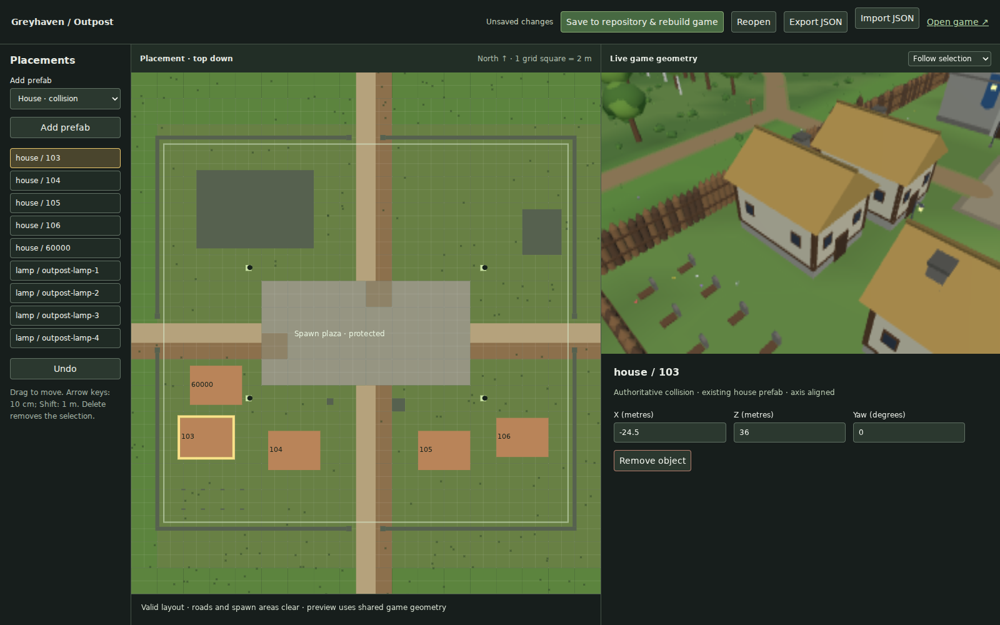

# Greyhaven layout editor

The first region is the Outpost interior (62 × 58 m). The separate authoring page edits its four existing houses and lamp placements, adds houses/lamps/signs/flowers, removes placements, and previews the shared game geometry. Terrain, keep, inn, smithy, walls, doors, NPCs and arbitrary generated scatter remain locked context. Existing house prefabs are axis aligned; decorative props can rotate.



## Use

Prerequisites are the browser game's Rust toolchain, WASM target, matching wasm-bindgen CLI and Bun. Run from the repository:

```sh
scripts/fetch-bundles.sh
cd web
bun install --frozen-lockfile
bun run editor
```

Open the printed local URL with `/mmorpg/editor.html`. Select an object from the list or canvas. Drag it, enter exact X/Z in metres, or focus the map and press arrow keys (10 cm; Shift: 1 m). Add a prefab at its initial free plot, then move it. Delete or **Remove object** removes the selected placement; **Undo** restores the preceding accepted edit. The 3D preview can show the Outpost or follow the selection. Selection is retained in the URL.

Invalid edits report the reason and preserve the accepted state. Houses must keep their entire footprint inside the authoring region, clear of roads, the spawn plaza, existing collision, creature/NPC spawns, the graveyard and authored routine constraints. Decoration cannot obscure the protected roads/plaza or intersect structures, but never creates collision.

**Save to repository & rebuild game** validates both owners, atomically replaces `content/greyhaven/outpost-layout.json`, and rebuilds WASM. Wait for completion, then use **Open game** or reload an existing game tab. **Reopen** reloads the saved file; discarding unsaved changes requires confirmation. Externally changed files cause a conflict rather than an overwrite. The local authoring server binds loopback and accepts only same-origin saves, with a bounded request size. It is never part of a zone host or the published site.

The public editor page supports preview and JSON import/export. To use an exported layout, import it in the local editor and save, or replace the repository file and run the validator below. Native hosts/clients consume the same committed file on their next build; the native development launcher watches it. Running sessions retain their existing immutable content, and old checkpoints fail closed if gameplay fingerprints differ.

## Saved representation and ownership

- `version: 1` and `generator: "greyhaven-15"` identify the schema and deterministic base. Generator changes require an explicit override rebase; unknown versions fail closed.
- `collision` is the override layer. IDs 103–106 identify existing houses; 60000–64999 identify persistent author additions. `position` is exact `[x, z]` in centimetres. `removed: true` suppresses a base placement. Reopening retains the IDs; deletion does not shift identities. Core reuses the existing house footprint and owns final gameplay validation.
- `decoration` contains the saved presentation placements, with persistent textual IDs, prefab `kind`, centimetre coordinates and `u16` yaw. It overrides the four existing Outpost lamps while retaining the original base generator. Scenery owns this schema; core ignores it. Other fixed/procedural decoration remains in its existing generator.
- Regeneration always starts from the unchanged base. House edits neither reseed nor reroll scatter. Presentation suppresses scatter intersecting the resulting houses; it does not create another collision solver. Layout composition is deterministic and idempotent.

The content revision is 16 for this format adoption; collision changes alter the existing canonical content fingerprint. Treat a published gameplay layout as immutable: record a new content revision and refresh its existing content fixture when publishing later collision changes. Decorative-only edits retain gameplay identity. The format is intentionally limited to the proven palette, not a new mesh importer or asset catalog.

## Checks

```sh
cargo run --locked -p mmorpg-scenery --example validate-layout -- content/greyhaven/outpost-layout.json
cargo test --locked -p mmorpg-scenery --test layout_editor
python3 scripts/smoke-layout-editor.py
```

The focused browser journey requires the existing Playwright prerequisite and built WASM. It edits/nudges/adds/removes/undoes, saves and rebuilds, reopens, then enters the actual game and checks its compiled house location. It restores the original layout and rebuilds WASM on exit; don't run it against another active editor. Screenshots are written to `artifacts/layout-editor/`. Optional `BROWSER_EXECUTABLE` selects an installed Chromium; `MMORPG_BROWSER_SINGLE_PROCESS=1` supports environments without browser subprocess sockets.

This implements Atlas 5.1.81 / TECH-010 and continues TECH-008/TECH-009. It does not reopen the completed valley expansion (#159/#308) or duplicate building (#158), cave (#160), or asset normalization (#53) ownership.
