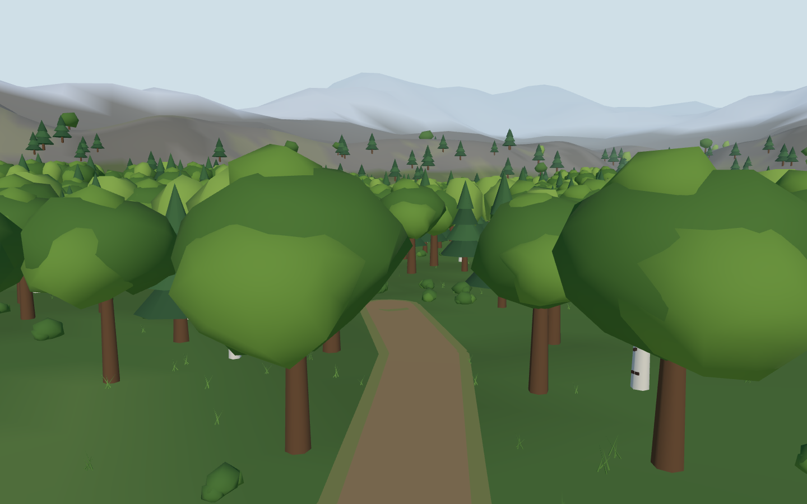
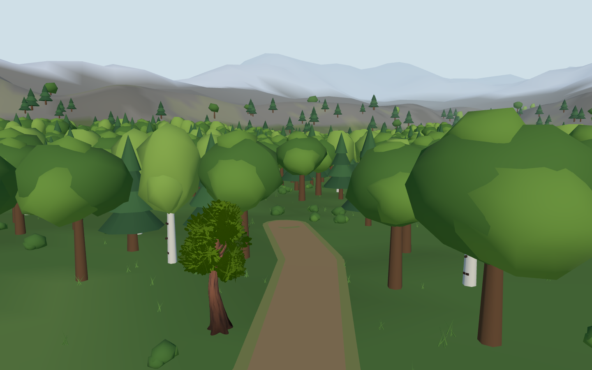
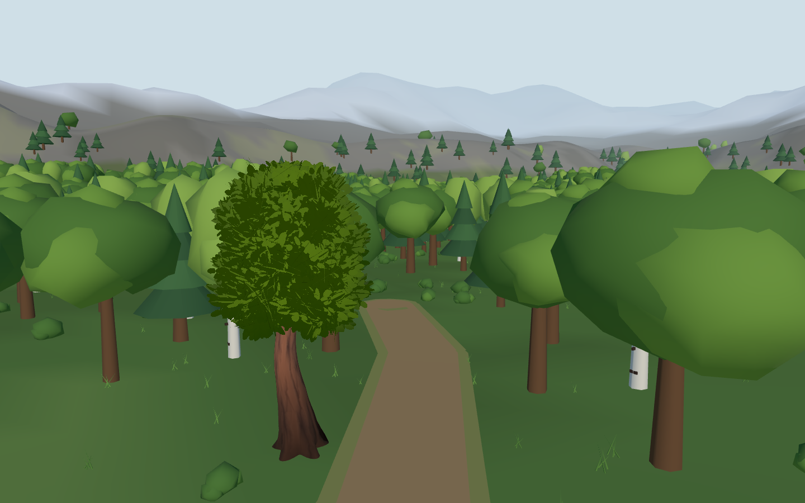

# Greyhaven broadleaf review

> **History.** The owner approved the reworked broadleaf and detailed trees and rocks everywhere (#49, 2026-10-31); both clients now draw the `greyhaven-nature` bundle by default and the opt-in review toggle and `scripts/fetch-nature-review.sh` are gone. The record below is the original review.

This is the first environment comparison for [#346](https://github.com/moenarch-games/mmorpg/issues/346), following Atlas 6.3.8. **The default game still uses the current procedural oak.** **Owner feedback (2026-10-20):** the denser, taller prototype is better, but its leaf colours and the current lighting are unsatisfactory. Defer further tree iteration and adoption until lighting can be revisited; this is not approval to replace default art. Full tree/rock adoption remains [#49](https://github.com/moenarch-games/mmorpg/issues/49).

Both images are actual Chromium browser-game captures: existing `woods` camera, 1440 × 900, presentation time 120 seconds, reduced motion, identical paused authoritative projection. The HUD is hidden equally for readability. One oak left of the path changes; all other scenery stays current. The proposed broadleaf is visibly smaller and more detailed than the current crown; this review does not approve its scale or colour.

Current — shared procedural oak, MMORPG renderer integration `3bbac0585578a899f7afb18d42f6c443f0f380d8`, `3d-lab` renderer `235774615f1367065093deb6988f5217bdf4d7e1`, three.js 0.186.1:



Candidate — `greyhaven.nature.tree.broadleaf/default`, same game/renderer revisions and scene:



## Denser, taller prototype

A further Blender 5.2.2 LTS authoring experiment keeps the original trunk and adds two foliage-only copies rotated 120° and 240°. The game draws it at eight metres rather than the first five-metre fit, with the same `woods` camera, time and viewport. This is an actual browser-game render; default art is unchanged. This prototype is **not the published nature bundle**: its source packaging and consumer adoption are deferred with the owner’s lighting revisit. It is retained as experimental visual evidence, not as a reproducible published asset. The optional runtime toggle below continues to load the original published candidate. The original comparison and release identities below describe the first candidate.



## Artifact actually shown

- [Published nature bundle](https://github.com/moritzbrantner/asset-tooling/releases/tag/greyhaven-nature), producer revision `98c503750a013e38ebb9ce17f7333ee8841f03e8`.
- Tar SHA-256: `56da6aacc505b9f4dcefbdf65ec5317a8d6bba682a224510853a94437838227f`.
- Content-only export ref SHA-256: `91063f8a717848b003a9641bc8fc14835206b9481df5af8bf4adf40a195b4550`.
- Source: CC0 Quaternius Stylized Nature MegaKit, `glTF/CommonTree_1.gltf`, 6,265 triangles. [Producer provenance and recipe](https://github.com/moritzbrantner/asset-tooling/blob/98c503750a013e38ebb9ce17f7333ee8841f03e8/docs/greyhaven-nature-bundle.md).
- Existing [asset-tooling gallery](https://moritzbrantner.github.io/asset-tooling/) provides producer previews and tools. It is a separate deployment; **this comparison does not claim that its current Pages build shows this nature bundle**. The release and these game captures identify the actual candidate.
- Existing scenery placement index 208, collider ID 1115, anchor X/Z `(-59.91, 10.27)` metres, unchanged yaw. Uniform scale `0.6882515948` fits the imported shape to the existing five-metre body height; feet use the same rendered terrain surface. [Capture metadata](capture.json) records the actual transform and original collider.

## Reproduce or try the candidate

From this checkout:

```sh
bash scripts/fetch-bundles.sh
bash scripts/fetch-nature-review.sh
(cd web && bun run build)
uv run --with playwright==1.57.0 python scripts/smoke-browser.py BrowserAcceptance.test_nature_candidate_at_the_same_woods_camera
```

The optional fetch verifies the exact tar hash and never runs in ordinary builds. A changed rolling release fails the pin check rather than silently changing the review input. Captures are written to ignored `artifacts/browser/`; the two requested review images above are retained here for direct phone access.

For interactive inspection, run `cd web && bun run dev`, open the printed local URL with `?debug`, enter the world, then use the existing debug console:

```js
__valeDebug.flyTo('woods');
__valeDebug.setPresentationTime(120);
await __valeDebug.setNatureCandidate(true);
// Return to accepted art:
await __valeDebug.setNatureCandidate(false);
```

The toggle is session-only and explicitly requested through the debug API. It reuses the inn's standard three.js GLTFLoader and imported-root renderer path. The WASM presentation export clones scenery and omits only this oak before batching; the local host never reads that copy. It does not write placement, collider, tick, protocol, snapshot, save or preference state. Reloading starts with current art.

Verified: production WASM/TypeScript/Vite build and the focused Chromium comparison, including candidate loading, unchanged authoritative projection and restoration of current art. Native equivalence, other tree/rock families and hardware GPU appearance remain unverified. Shared convention source revision: `6cc05789dab39cee6758b288f83fb48b4ee6dbdb`.
