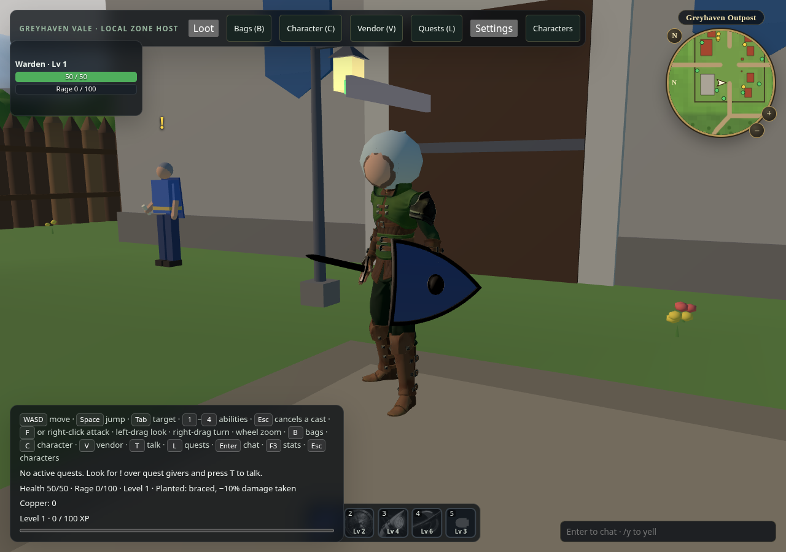
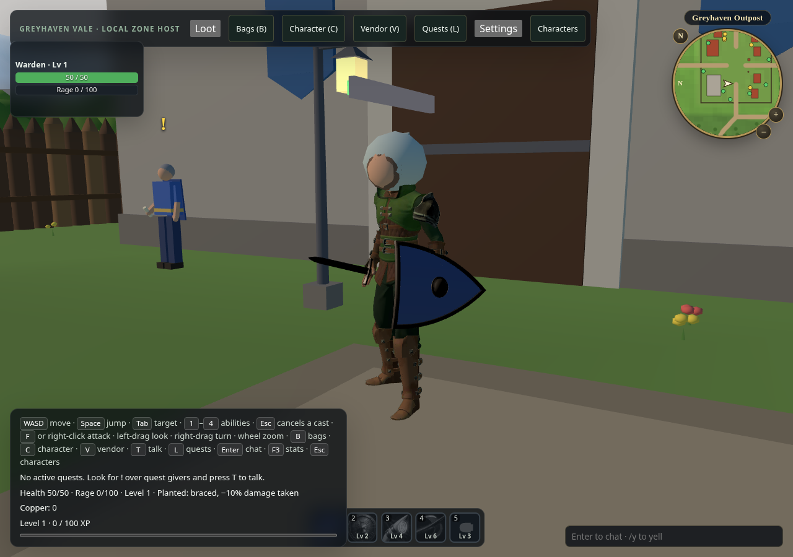

# Rolling Ranger adoption

Actual Greyhaven browser game, same default Dark archer, player 1 at `[-15.5, 0, 12.5]`, `Idle_Loop` at time 0. Viewport 1280 × 900; fixed animation-frame time 1000 ms; camera eye `[-13.5, 1.6, 16]`, target `[-15.5, 0.9, 12.5]`. Both renders use Three.js 0.186.1 and renderer `bfeb9fafd8fef541e51236bf76b5b57ab73213d4`; no world, lighting or gameplay changes are part of this asset adoption.

- Before: game source `9f9323d`, accepted `humanoid-ranger-male-v7`; bundle export `f211bdbdcf086a4af1c887afa9ecbd34ad7945ca1067f72ef119182a8d3ed8c7`.
- After: game source `7b6d7e46036788ae7ec207f5cdbe1f5e1b614ff9`, rolling `humanoid-ranger-male` bundle export `3c2c5d06a6395a7caca25069e6e12749ab49ceda493ade950ebd12ca09513c58`. Selected default entries are packed from that unchanged bundle with asset-tooling `e0815d814df31d11d27ae0293a56fa90e43a3873`, preserving equipment grip frames. The game loads those per-entry Meshopt/KTX2 downloads and their shared animation library.

The [existing producer inspection surface](https://moritzbrantner.github.io/asset-tooling/) and [Ranger comparison documentation](https://github.com/moritzbrantner/asset-tooling/blob/main/docs/animation-viewer.md#ranger-comparison) remain available. These images identify the actual output inspected here; they do not assert that a cached Pages comparison has refreshed.

Before:

After:

