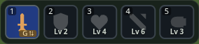
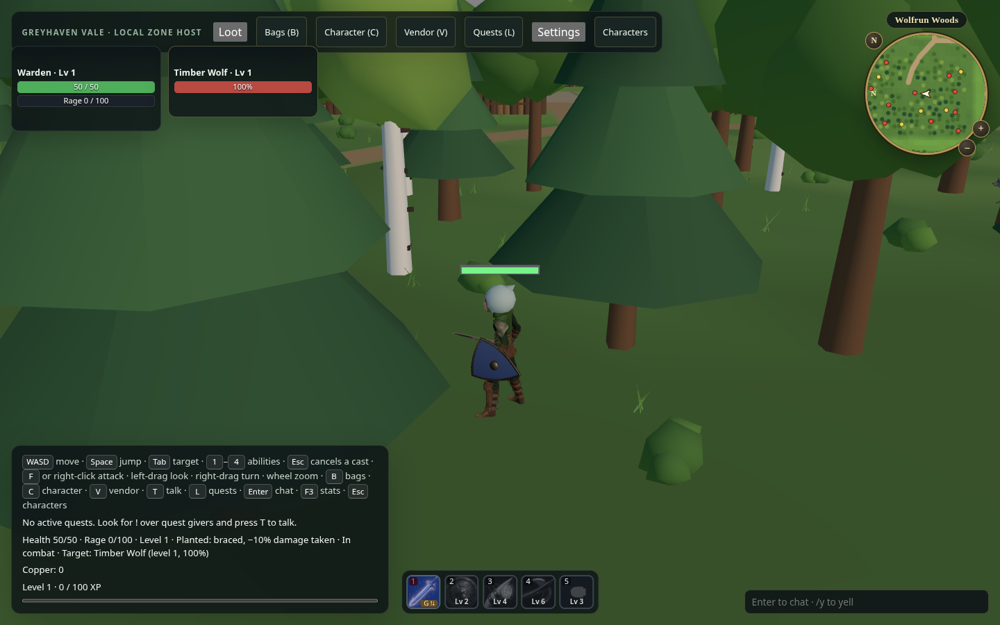
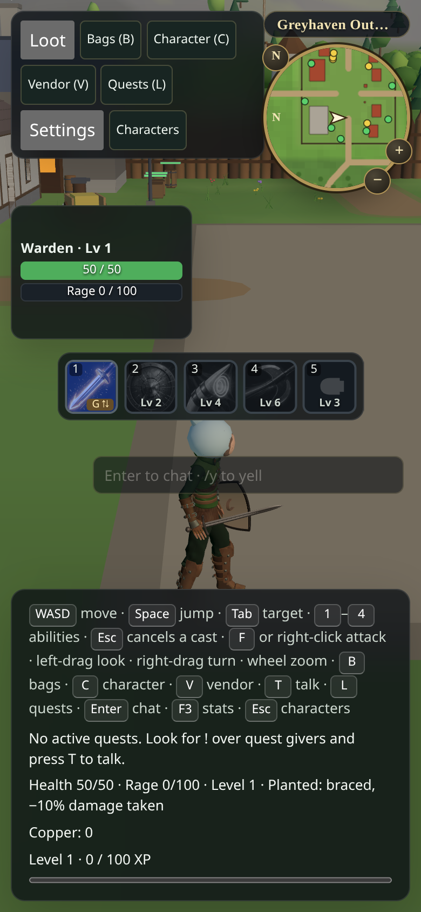

# Warden hotbar comparison

Before: actual public [MMORPG Pages game](https://moritzbrantner.github.io/mmorpg/), prior to the icon consumer change. [Capture metadata](before-public.json) identifies its loaded game modules. The fifth slot is the existing Charge ability.

After: actual local production build, game integration `6b910fe`, with the same four owner-approved painted ability identities. This is **local browser evidence**, not a claim that the public game already deployed the change. Scene/camera differ; the comparison concerns the action bar.

Touch/high-DPI: actual Chromium 390×844 viewport at DPR 2, using the approved larger derivatives. Locked abilities remain grey with their authoritative level requirements; Charge keeps its existing glyph.

[Source identities, license, build-time validation and reproduction](../../WARDEN_ABILITY_ART.md). No new artwork was generated for these game captures. Native presentation remains #171.
